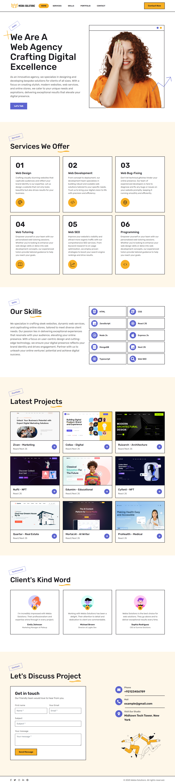

# NextLevel Play – Modern Digital Agency & Creative Web Studio

<div align="center">

[](https://nextjs.org/)
[](https://reactjs.org/)
[](https://getbootstrap.com/)
[](https://sass-lang.com/)
[](https://opensource.org/licenses/MIT)

</div>

**NextLevel Play** is a premium, high-performance digital agency web application developed with **Next.js** and styled with modular **CSS/SCSS**. Tailored for forward-thinking creative agencies, digital studios, and technology consultancies, it offers a seamless showcase of cutting-edge web design, robust engineering services, interactive project portfolios, client testimonials, and multi-channel communication hubs.

---

## 📖 Overview



NextLevel Play combines clean aesthetics, modern typography, responsive layouts, and interactive micro-animations to deliver a standout agency presence. Designed with user engagement and brand credibility in mind, the platform enables clients to explore specialized capabilities, review verified case studies, and initiate project discussions effortlessly.

---

## 🚀 Key Website Features

### 🖥️ 1. Hero & Brand Introduction
- **High-Impact Typography**: Striking headlines, animated badge accents, and geometric effects.
- **Clear Call-to-Action (CTA)**: Immediate access to the consultation contact form.
- **Interactive Visuals**: Clean vector banner art and decorative SVG backdrops.

### 🛠️ 2. Comprehensive Services Catalog
Structured service cards highlighting six core offerings:
1. **Web Design**: User-focused UI/UX design creating visually captivating, high-converting digital storefronts.
2. **Web Development**: Robust frontend and full-stack web applications engineered for scalability and speed.
3. **Web Bug-Fixing**: Rapid diagnostics and resolution for UI glitches, responsive bugs, and script bottlenecks.
4. **Web Tutoring**: Customized training and technical mentoring for engineering teams and individuals.
5. **Web SEO**: Keyword strategies, metadata optimization, and technical SEO to maximize organic traffic.
6. **Programming**: Custom software algorithms, API integrations, and bespoke backend architectures.

### 🧠 3. Tech Stack & Skills Matrix
Interactive technology cards detailing the agency's primary competencies:
- **Frontend**: HTML5, CSS3/SCSS, JavaScript (ES6+), TypeScript, React.js, Next.js
- **Backend & Database**: Node.js, Express.js, MongoDB
- **Optimization**: Web SEO, Performance Auditing, Mobile-First Responsiveness

### 📂 4. Curated Portfolio (9 Case Studies)
Diverse showcases spanning multiple modern industries:
- **Zivan** – Marketing & Brand Growth Platform *(React / Next.js)*
- **Collax** – Digital Agency & SaaS Interface *(React / Next.js)*
- **Ruizarch** – Architecture & Interior Design Studio *(React / Next.js)*
- **Nufti** – Web3 & NFT Marketplace *(React.js)*
- **Edumim** – Educational LMS & Learning Hub *(React / Next.js)*
- **Cyfonii** – NFT & Blockchain Showcase *(React.js)*
- **Quarter** – Real Estate & Property Listing Platform *(React / Next.js)*
- **Mortal.AI** – AI Content Generation Tool *(React / Next.js)*
- **ProHealth** – Healthcare & Medical Services Portal *(React.js)*

### 💬 5. Client Testimonials Slider
- **Swiper-Powered Lightbox Carousel**: Smooth touch-enabled review carousel highlighting genuine client endorsements from industry leaders (Founders, CEOs, and Product Managers).

### 📞 6. Contact & Consultation Hub
- **Interactive Inquiry Form**: Validated contact form powered by EmailJS for direct client messages.
- **Multi-Channel Contact Matrix**: Structured primary and alternative communication channels.

---

## 📌 Contact Matrix & Support Channels

NextLevel Play provides accessible communication channels with dedicated primary and alternative lines:

| Channel | Primary Detail | Alternative / Support Detail | Availability |
| :--- | :--- | :--- | :--- |
| 📞 **Phone** | [`+1 (800) 555-0199`](tel:+18005550199) | [`+1 (800) 555-0144`](tel:+18005550144) *(Support Hotline)* | Mon – Fri (9 AM – 6 PM EST) |
| ✉️ **Email** | [`hello@nextlevelplay.com`](mailto:hello@nextlevelplay.com) | [`support@nextlevelplay.com`](mailto:support@nextlevelplay.com) *(Help Desk)* | 24/7 Digital Intake |
| 🏢 **Studio / Office** | **Midtown Tech Tower**, New York, NY | **Innovation Hub**, Suite 400, Austin, TX | By Appointment |
| ⏰ **Operating Hours** | **Mon – Fri:** 09:00 AM – 06:00 PM EST | **24/7 Client Emergency Desk** *(Active Contracts)* | Standard & On-Call |

---

## ⚙️ Tech Stack & Libraries

- **Framework**: [Next.js](https://nextjs.org/) (SSR & SSG page architecture)
- **UI Library**: [React 18](https://reactjs.org/)
- **Styling**: [Bootstrap 5](https://getbootstrap.com/), [SCSS](https://sass-lang.com/), and Vanilla CSS
- **Iconography**: [Font Awesome Free](https://fontawesome.com/) & [React Icons](https://react-icons.github.io/react-icons/)
- **Slider**: [Swiper](https://swiperjs.com/)
- **Email Delivery**: [@emailjs/browser](https://www.emailjs.com/)

---

## 📁 Project Structure

```text
NextLevel-Play/
├── pages/
│   ├── api/
│   │   └── hello.js           # API health check endpoint
│   ├── _app.js                # App wrapper, global fonts & page title
│   ├── _document.js           # Document structure & SEO meta tags
│   └── index.js               # Main homepage assembler
├── public/
│   ├── assets/
│   │   ├── css/               # Compiled stylesheet
│   │   ├── img/               # Brand logos, avatars, banners & SVG icons
│   │   ├── scss/              # SCSS architecture & variables
│   │   └── vendor/            # FontAwesome, Bootstrap & Owl Carousel
│   └── favicon.png            # Application browser favicon
├── src/
│   ├── components/
│   │   ├── popup/             # Modal / lightbox components
│   │   ├── Contact.js         # Contact section with primary & alternative info
│   │   ├── Footer.js          # Footer with social links & copyright
│   │   ├── Header.js          # Navigation bar with responsive menu
│   │   ├── Home.js            # Hero section with headline & CTA
│   │   ├── Portfolio.js       # 9 featured projects grid
│   │   ├── Preloader.js       # Animated site loading state
│   │   ├── SectionTitle.js    # Reusable section heading component
│   │   ├── Services.js        # Core agency services grid
│   │   ├── Skill.js           # Tech stack & skills matrix
│   │   └── Testimonial.js     # Swiper client testimonial carousel
│   ├── sliderProps.js         # Swiper configurations
│   ├── useClickOutside.js     # Custom hook for dropdown/nav handling
│   └── utils.js               # Helper utilities (SVG inline replacer, nav scroll)
├── styles/
│   └── globals.css            # Global CSS imports
├── README-IMGS/
│   └── preview.png            # Visual preview asset
├── package.json               # Node packages and build scripts
└── README.md                  # Comprehensive project documentation
```

---

## 💻 Getting Started Locally

### Prerequisites
- [Node.js](https://nodejs.org/) (version 18.x or later recommended)
- [npm](https://www.npmjs.com/) or [yarn](https://yarnpkg.com/)

### 1. Clone the repository
```bash
git clone https://github.com/your-username/NextLevel-Play.git
cd NextLevel-Play
```

### 2. Install dependencies
```bash
npm install
```

### 3. Launch local development server
```bash
npm run dev
```

Open [http://localhost:3000](http://localhost:3000) with your browser to view the application.

### 4. Build for Production
To create an optimized production build:
```bash
npm run build
npm run start
```

---

## 📧 EmailJS Configuration

To connect the contact form in [src/components/Contact.js](file:///c:/Users/QBS%20Accounting/Documents/websites/NextLevel-Play/src/components/Contact.js) to your own mailbox:
1. Create a free account at [EmailJS](https://www.emailjs.com/).
2. Create an Email Service and Note your `Service ID`.
3. Create an Email Template and Note your `Template ID`.
4. Copy your `Public Key` (Account API Keys).
5. Update lines 51–54 of [Contact.js](file:///c:/Users/QBS%20Accounting/Documents/websites/NextLevel-Play/src/components/Contact.js#L51-L54) with your credentials.

---

## 📄 License & Attribution

- **License**: Released under the [MIT License](https://opensource.org/licenses/MIT).
- **Brand Identity**: NextLevel Play.
- **Original Foundation**: Developed by Ahad Ali (`@ahadalireach`), enhanced by `@abuzar-alvi`.
